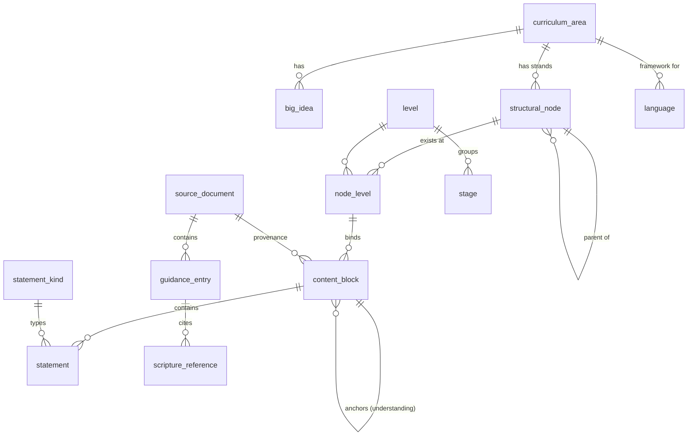

# CIC Curriculum Data Model

A data model for serving the CIC Draft Technical Frameworks (November 2026) and their supporting guidance through a web service.

| File | What it is |
|---|---|
| `schema.sql` | PostgreSQL 15+ schema: tables, integrity triggers, read views, seed reference data |
| `curriculum.schema.json` | JSON Schema (2020-12) for import/export documents and API response shapes |
| `examples/` | Sample data excerpted from the real PDFs (Technologies, Maths, French guidance, RC Scripture) |
| `tools/validate.py` | Validates import files: JSON Schema + cross-reference rules |
| `tests/schema.test.mjs` | Loads the schema and seed into an in-memory Postgres (PGlite) and checks views and constraints |
| `tools/extract/` | PDF → JSON extraction pipeline (see *Extracting a framework*) |
| `tools/to_sql.py` | Turns an area JSON file into SQL that loads (or reloads) it into the database |
| `web/` | Curriculum Explorer: static site for browsing the extracted areas |
| `data/` | Extracted areas: `<area>.area.json`, plus `<area>.review.html` / `.review.json` for checking |

## The model



How your overview maps onto it:

| Overview concept | Model |
|---|---|
| Curriculum Area, Purpose Statement | `curriculum_area` (`purpose_statement`) |
| Big Idea(s) with description | `big_idea` |
| Strand / Sub-strand / Sub-sub-strand | `structural_node`: one recursive table with `node_type` and `parent_id`. A trigger enforces strand → sub-strand → sub-sub-strand order and keeps a materialised `path` (`ideas/business`) |
| Five learning levels | `level` lookup table |
| Strands vary by level (Data Rich World: Third–Fourth only) | `node_level`: a block can only exist where its node exists at that level (foreign key) |
| Content Block bound to one node and one level | `content_block (node_id, level_code)` |
| Understanding Statement anchors the payload | `content_block.understanding` |
| Know, Do, Notes | `statement` rows with `kind` = `know` / `do` / `note` |
| Understanding at a lower node (Science, Maths) | Put the block on the sub-strand or sub-sub-strand; nothing special is needed |
| Level-specific payloads | Every block belongs to exactly one level |

## What the documents need beyond the overview

I checked the overview against all 27 PDFs. These are the variations the model handles:

| Found in the documents | How it is modelled |
|---|---|
| **Understanding on the strand, Know/Do on each sub-strand.** Technologies Third and Fourth Level: one Understanding for IDEAs, with separate payloads for Business, Design and Engineering, and Computing Science. | A block either *owns* an Understanding (it is an **anchor**) or *inherits* one through `anchor_block_id`. A trigger checks that the anchor is at the same level, on the same node or an ancestor, and has an Understanding. An anchor can't drop its Understanding, or move, while other blocks depend on it. |
| **Several Understandings per node and level** (Sciences, Maths, RMPS, Languages) | Several anchor blocks on the same `(node, level)`, ordered by `position` |
| **Beginning / End of level** (Maths, ASN Milestones) | `statement.phase` = `beginning` / `end` |
| **"Includes, but not limited to"** (Technologies, Sciences, Gàidhlig, RMPS…) | `statement.kind = 'includes'` |
| **"Excludes"** (Technologies: content explicitly out of scope at a level, e.g. binary-to-decimal conversion) | `statement.kind = 'excludes'` |
| **"New key mathematical language"** | `statement.kind = 'vocabulary'` |
| **ASN Milestones** layered onto Literacy and Maths | `statement.kind = 'milestone'`, with `source_document_id` pointing at the ASN document |
| **Foundation ASN Milestones**, which come before Early Level | `level = 'foundation'` (`is_bge = false`) |
| **Do-column qualifiers** ("through play, everyday routines…") | `content_block.metadata.doQualifier` |
| **Bilingual names** (Literacy and Gàidhlig: *Feartan na Gàidhlig / Features of the Gaelic Language*) | `curriculum_area.content_language` plus `translations` JSONB on areas, Big Ideas and nodes |
| **Language progression guidance** (French, German, Spanish → Languages; Latin → Languages Latin; Gaelic and Scots Learners → their own frameworks) | `language` (which framework each language follows) plus `guidance_entry` rows with `kind` = `level_descriptor`, `language_exemplar`, `grammar_progression`, `progression_example`, `commentary` or `suggested_context`. `mode` = `receptive` / `productive` covers the Understand / Use columns. |
| **RC Scripture Texts** by strand × level × year group (P2–S6, plus Senior Phase) | `guidance_entry.kind = 'scripture_text'` with `node_id`, `level_code` and `stage_code`. Passages go in `scripture_reference`. `ref_selection` = `all` / `choose` / `examples`, and `ref_choose_min` holds the count ("one of" = 1, "two or more of" = 2). |
| **Compilations** (Early Level; Big Ideas and Purpose Statements) and the **Building Scotland's Curriculum** overview | Recorded as `source_document` rows only. Their content is a *view* over the area data, not a second copy. |
| **Versioning** (everything is draft v1.0) | `source_document.version`, `status` and `supersedes_id`; each block and statement records its source document and page |

### Document → model map

| Document | Loads into |
|---|---|
| 15 technical frameworks (Technologies, Sciences, Maths, Languages ×4, Literacy ×2, HWB, Social Studies, RMPS, RERC, Expressive Arts, Foundation ASN) | `curriculum_area`, `big_idea`, `structural_node`, `node_level`, `content_block`, `statement` |
| Literacy and English ASN; Numeracy and Mathematics ASN | `statement` (`kind = 'milestone'`) on the matching Literacy / Maths blocks |
| Progression Guidance: French, German, Spanish, Latin, Gaelic (Learners), Scots (Learners) | `language`, `guidance_entry` |
| RERC Scripture Texts | `guidance_entry` (`scripture_text`), `scripture_reference` |
| Early Level; Big Ideas and Purpose Statements; Building Scotland's Curriculum | `source_document` only (cross-area views) |

## Stable identifiers

Rows have UUID primary keys. Blocks and statements also get a human-readable `code`, unique across the service, for URLs, trackers and cross-references:

```
TCH.IDEAS.3.1          Technologies › IDEAs › Third › anchor 1
TCH.IDEAS.BUS.3.1      … › Business sub-strand (inherits from TCH.IDEAS.3.1)
TCH.IDEAS.BUS.3.1.K1   … › Know statement 1
MNU.QNA.NSS.E.1.BK1    Maths › … › Early › Beginning-of-level Know 1
```

The codes in the examples are a proposed convention. They aren't official codes from the documents.

## Suggested API surface

The read views (`v_content_block`, `v_summary_of_progression`) do most of the work behind these endpoints:

| Endpoint | Returns |
|---|---|
| `GET /levels`, `GET /stages` | Reference data |
| `GET /areas` | Areas with purpose statements |
| `GET /areas/{slug}` | Area plus Big Ideas; `?expand=tree` returns an `AreaDocument` |
| `GET /areas/{slug}/progression` | Summary of Progression grid (strand × level → Understanding) |
| `GET /areas/{slug}/nodes/{path}?level=third` | A node, its children, and blocks at that level |
| `GET /blocks/{code}` | `ResolvedBlock`: Understanding resolved from the anchor, statements grouped into know / do / notes / includes / excludes / vocabulary / milestones |
| `GET /levels/{level}/blocks?area=…` | Cross-area view by level (what the Early Level PDF compiles) |
| `GET /search?q=…&area=…&level=…&kind=…` | Full-text search over statements (`statement.search` GIN index) |
| `GET /languages/{code}/guidance?level=…&kind=…` | Progression guidance for one language |
| `GET /areas/re-roman-catholic/scripture?level=…&stage=…&strand=…` | Scripture texts with references |

## Running the checks

```bash
cd model
npm install                  # installs PGlite (Postgres compiled to WebAssembly), no database server needed
npm run test:db              # schema + seed + views + 13 integrity checks

pip install jsonschema
npm run validate             # validates examples/*.json
python3 tools/validate.py path/to/your-area.json
```

## Extracting a framework

```bash
pip install -r requirements.txt
tools/extract/run.sh technologies     # extract → coverage check → validate → review page
python3 tools/to_sql.py data/technologies.area.json > data/technologies.sql
```

`run.sh` reads `tools/extract/configs/<area>.json` (PDF name, page range, strand and sub-strand codes, name aliases) and:

1. **Extracts.** `layout.py` rebuilds each table from its ruled lines. `extract.py` then reads the rows (Strand, Sub-Strand, Understand, Know/Do, Includes/Excludes/Notes), joins text that runs over page breaks, and writes `data/<area>.area.json`.
2. **Checks coverage.** `coverage.py` confirms every word in the source tables appears in the output exactly as often, and that nothing was added.
3. **Cross-checks.** Each Understanding is compared with the Summary of Progression table. Results are recorded in `data/<area>.review.json`.
4. **Validates.** The output is run through `tools/validate.py`.
5. **Writes the review page.** `review.py` produces `data/<area>.review.html`: each PDF page beside what was extracted from it, with flagged statements highlighted.

Fix problems by editing the area config (codes, aliases) and re-running. Fix a problem in the source text itself in the JSON after review, or better, in the next PDF release.

## Curriculum Explorer (web interface)

A static site in `web/` (plain HTML, CSS and JavaScript, no build step) that reads `data/areas.json` and each `<area>.area.json`:

- **Understandings:** a matrix of strands × levels. Each cell shows the Understand statement and tags for the sub-strands at that level; a tag opens that sub-strand at that level, filtered to that strand.
- **Purpose and big ideas:** the purpose statement, the Big Ideas, and the structure at each level: a strand → sub-strand tree per level, with strands in aligned rows.
- **Progression:** a matrix of strands (rows) by levels (columns); read across a row to see how a strand develops from Early to Fourth Level. Each strand expands to show its sub-strands as indented rows. A switch picks what the cells show: Understand, Know, Do or Notes (includes, excludes and notes). Where a strand is split into sub-strands, its cell offers "In N sub-strands", which expands it. The URL keeps the cell choice and expanded strands, e.g. `#/technologies/progression?show=d&open=systems`.
- **By level:** every strand at one level, with its Understanding, Know, Do, Includes, Excludes and Notes.
- **By strand:** the Understanding at each level, then each level in full.
- **By sub-strand:** select one or more sub-strands to see them gathered from every strand they appear in, grouped by level and filterable by strand. The selection is part of the URL (e.g. `#/technologies/substrand/business,cyber`), so it can be bookmarked.

```bash
cd model && npm run web      # then open http://localhost:8080/web/
```

`run.sh` keeps `data/areas.json` up to date, so a newly extracted area appears in the area picker automatically.

## Not modelled yet

- **Images and diagrams** (e.g. Maths uses images from MathsBot, Mathigon and others): add a `media` table linked to statements when needed.
- **Statement-to-statement links across areas** (interdisciplinary connections): add a `statement_link (from_id, to_id, relation)` table.
- **Tracking learner progress** against statements is a separate domain. It can reference `statement.code` and `content_block.code`.
- **Full-text search** uses the `simple` text-search configuration so Gaelic, Scots and Latin content isn't stemmed as English. Switch individual areas to `english` if you want stemming.
